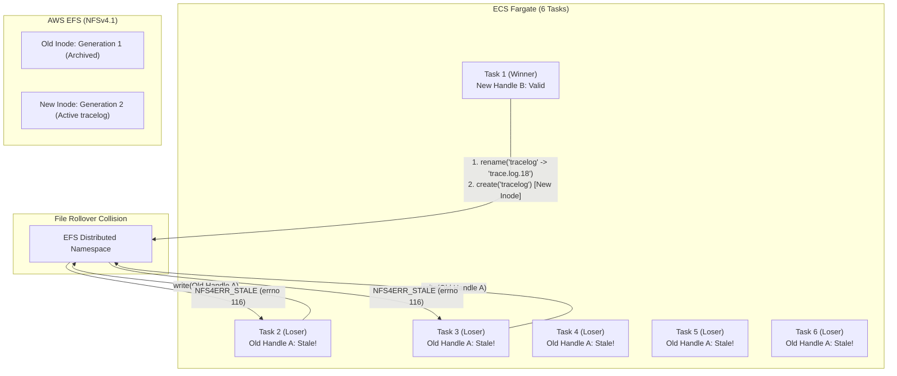
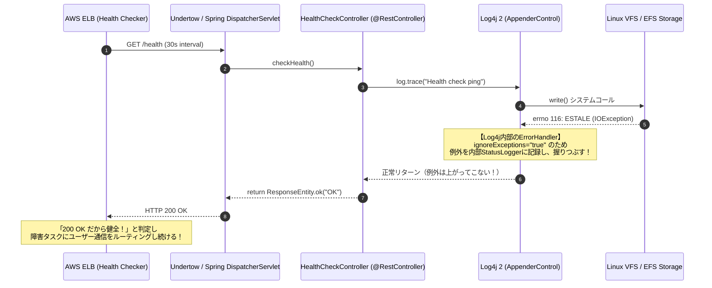
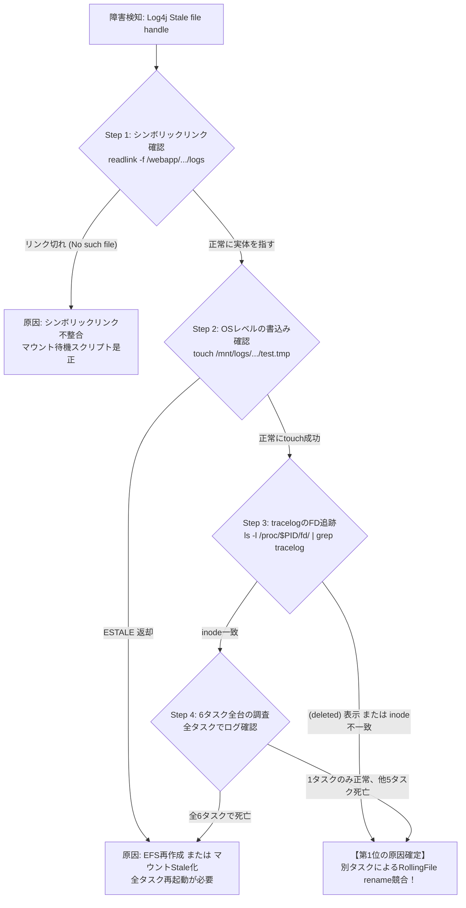
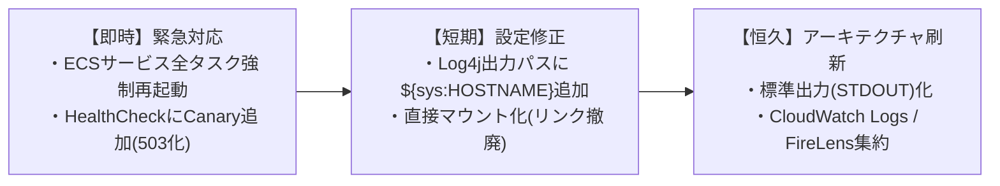

# 【技術白書】ECS Fargate + EFS 環境における `java.io.IOException: Stale file handle` (ESTALE) の深層分析・仮説検証と恒久対策マニュアル

---

## 目次

1. [エグゼクティブサマリ](#1-エグゼクティブサマリ)
2. [小学生にもわかる！「Stale File Handle」と「6タスク競合」のたとえ話](#2-小学生にもわかるstale-file-handleと6タスク競合のたとえ話)
   - 2.1 登場人物の紹介
   - 2.2 ふだんの平和なルール（整理券とロッカー）
   - 2.3 大事件！1人だけのノート取替と残された5人の悲劇
   - 2.4 なぜ職員室の連絡帳（ミドルウェアログ）は無事だったのか？
3. [ユーザー2大仮説の徹底検証](#3-ユーザー2大仮説の徹底検証)
   - 3.1 仮説1：アプリデプロイ・起動中にEFSをテスト目的で再作成した
   - 3.2 仮説2：全6タスクが同一ディレクトリの同一ファイル（tracelog）に書き込んでいる
4. [謎の解明①：なぜ6タスク中「1タスクのみ正常」という事象が起こり得るのか？](#4-謎の解明なぜ6タスク中1タスクのみ正常という事象が起こり得るのか)
   - 4.1 Log4j 2 `RollingFileAppender` のローテーション競合メカニズム
   - 4.2 「リネーム勝者（Winner）」と「置き去りにされた敗者たち」
   - 4.3 JBossミドルウェアログ（タスク別分離）が無事である決定的根拠（対照実験）
5. [謎の解明②：なぜSpring MVCヘルスチェックは例外を検知できず200を返し続けるのか？](#5-謎の解明なぜspring-mvcヘルスチェックは例外を検知できず200を返し続けるのか)
   - 5.1 Log4j 2 の基本設計思想：`ignoreExceptions="true"` の罠
   - 5.2 Spring MVC Controller と DispatcherServlet の例外伝播フロー
   - 5.3 「Javaで明示的にキャッチ＆スローすべきか？単なる実装ミスか？」の回答
   - 5.4 ELBが障害タスクへトラフィックを流し続ける危険性と是正策
6. [登場の歴史と背景：なぜNFSに「File Handle」と「ESTALE」が必要になったのか？](#6-登場の歴史と背景なぜnfsにfile-handleとestaleが必要になったのか)
   - 6.1 1980年代：Sun Microsystems と NFSv2 のステートレス設計
   - 6.2 なぜパス名ではなく「File Handle」なのか？
   - 6.3 なぜ「ESTALE（errno 116）」という安全装置が不可欠だったのか？
   - 6.4 現代の NFSv4.1 / AWS EFS への進化と分散共有の制約
7. [動作原理と内部メカニズム（Linuxカーネル VFS × NFS × JVM Log4j 2）](#7-動作原理と内部メカニズムlinuxカーネル-vfs--nfs--jvm-log4j-2)
   - 7.1 Linux VFSのオブジェクト構造（dentry, inode, file）
   - 7.2 NFS File Handle の内部構造と世代番号（Generation Number）
   - 7.3 コンテナエフェメラル領域からのシンボリックリンク解決（namei / follow_symlink）
   - 7.4 Log4j 2.25.3 が ESTALE を受け取るまでの完全コールスタック
8. [実際に発生する原因ランキング（可能性の高い順一覧）](#8-実際に発生する原因ランキング可能性の高い順一覧)
   - 【第1位】6タスク並行書き込みによる RollingFileAppender ローテーション競合
   - 【第2位】デプロイ/テスト時のEFSファイルシステムまたはディレクトリ再作成（rm -rf / mkdir）
   - 【第3位】シンボリックリンク作成タイミングとEFSマウントの競合（Dangling Symlink）
   - 【第4位】ECS Fargate と EFS 間の NFSv4.1 クライアント Lease 失効・瞬断
   - 【第5位】NFS属性キャッシュ（acregmin/max）の遅延による不整合
9. [事象の確認方法・問題の切り分けフロー（実践マニュアル）](#9-事象の確認方法問題の切り分けフロー実践マニュアル)
   - 9.1 コンテナ内調査（ECS Exec / コマンド群）
   - 9.2 ECS Fargate / インフラメトリクス調査
   - 9.3 1タスク生存・5タスク死亡の確認手順
   - 9.4 再現スクリプトと検証手順
10. [対処法一覧（緊急対応・根本対応・運用回避）](#10-対処法一覧緊急対応根本対応運用回避)
    - 10.1 【緊急対応】今すぐ復旧させる手順（即時解消・被害局所化）
    - 10.2 【根本対応】二度と発生させないアーキテクチャ刷新（恒久策）
    - 10.3 【運用回避】現行構成を維持する場合の運用ルール・スクリプト防壁
11. [本番適用コード＆設定ファイル完全集](#11-本番適用コード設定ファイル完全集)
    - 11.1 Log4j 2 設定の修正（タスク別分離案 ＆ 標準出力STDOUT案）
    - 11.2 Spring MVC ヘルスチェック Controller 改修（Storage Canaryチェック）
    - 11.3 ECSタスク定義（直接マウント化 ＆ シンボリックリンク撤廃）
    - 11.4 コンテナ起動スクリプト（安全なマウント待機とリンク生成）
12. [まとめと推奨アクションロードマップ](#12-まとめと推奨アクションロードマップ)

---

## 1. エグゼクティブサマリ

### システム構成と障害状況
- **実行環境**: AWS ECS Fargate（合計 6タスク 同時実行）
- **コンテナ構成（同一タスク内 2コンテナ）**:
  - フロントコンテナ: Red Hat Universal Base Image 9.8 (UBI 9.8) / OpenJDK 21 (Red Hat Build) / JBoss EAP 8.1
  - バックコンテナ: UBI 9.8 / OpenJDK 21 / JBoss EAP 8.1
- **ストレージ・マウント・シンボリックリンク構成**:
  - AWS EFS（Amazon Elastic File System, NFSv4.1）を各コンテナの `/mnt/logs` にマウント
  - フロントログ実体: `/mnt/logs/front/logs/inter-api`
  - バックログ実体: `/mnt/logs/back/logs/inter-api`
  - シンボリックリンク:
    - フロント: `/webapp/webapp9mf02/logs` $\rightarrow$ `/mnt/logs/front/logs/inter-api`
    - バック: `/webapp/webapp9mb02/logs` $\rightarrow$ `/mnt/logs/back/logs/inter-api`
- **ロギング構成**:
  - `log4j-api-2.25.3.jar`, `log4j-core-2.25.3.jar`, `log4j-slf4j2-impl-2.25.3.jar`
  - 設定ファイル:
    ```xml
    <Configuration>
      <Appenders>
        <RollingFile name="A4" fileName="${sys:iwin.log}/tracelog" 
                     filePattern="${sys:iwin.log}/trace.log.%d{yyyy-MM-dd-HH}">
          <Policies>
            <TimeBasedTriggeringPolicy />
          </Policies>
        </RollingFile>
      </Appenders>
      <Loggers>
        <Logger name="jp.iwin.base.tango.ILGLog4j.trace" level="debug" additivity="false">
          <AppenderRef ref="A4"/>
        </Logger>
      </Loggers>
    </Configuration>
    ```
- **発生障害**:
  - フロントコンテナ起動時、Log4j からログ書き込み時に `caused by java.io.IOException: stale file handle`（Linux errno 116: ESTALE）が発生。
  - しかし、ELBの30秒間隔ヘルスチェックは **HTTP 200** を返し続けており、エラータスクへ振り分けが継続。
  - 一方、JBoss EAPミドルウェアログ・GCログ・アクセスログ（`/mnt/logs/front/logs/inter-api/mid/{taskId}` 配下に分離）は一切エラーが出ず、正常にアプリのエラーを記録し続けている。

### 核心的結論
1. **ユーザー仮説の成否**:
   - **仮説1（EFS再作成）**: **【大いに成立する】**。EFSファイルシステム自体の再作成、あるいはEFS上のディレクトリを `rm -rf` して再作成した場合、inode番号とGeneration Numberが更新されるため、旧ハンドルを掴んでいたプロセスは確実に `ESTALE` になる。
   - **仮説2（6タスク同一ファイル書き込み）**: **【極めて有力かつ決定的な主因】**。6タスクが同一の `tracelog` に対して `TimeBasedTriggeringPolicy` でローテーションを行うと、あるタスクが `rename()` を実行した瞬間に他タスクのFile Descriptorが無効化され、恒常的に `ESTALE` が発生する。
2. **「1タスクのみ正常」という事象の科学的真実**:
   - **完全に起こり得ます（むしろ必然の現象）**。ローテーションを最初に実行した1タスク（Winner）だけが新しく作成された `tracelog` の有効なファイルハンドルを保持し、残りの5タスク（Losers）は古いファイルハンドルを掴まされたまま取り残されて `ESTALE` ループに陥るためです。
3. **ヘルスチェックが200を返し続ける理由**:
   - Log4j 2のAppenderはデフォルトで **`ignoreExceptions="true"`** となっており、ファイル書き込み例外（IOException）をフレームワーク内部の `DefaultErrorHandler` で握りつぶして標準エラーに出力するのみで、呼び出し元（Spring MVC Controller）へスローしません。
   - Controller側もログストレージへの書き込み検証を行っていないため、何事もなかったかのように `200 OK` をELBへ返し続けています。
4. **最推奨の恒久対策**:
   - **コンテナログのEFS直接書き込みを廃止し、標準出力（STDOUT）＋ CloudWatch Logs / FireLens（Fluent Bit）へ移行すること**（The Twelve-Factor App 原則）。
   - EFS直接出力を維持する場合は、Log4jの出力パスにタスクID `${sys:HOSTNAME}` を含めて**ファイル・ディレクトリをタスクごとに完全分離**し、シンボリックリンクを廃止してECSタスク定義で直接マウントします。

---

## 2. 小学生にもわかる！「Stale File Handle」と「6タスク競合」のたとえ話

小学生でも直感的に理解できるように、学校の「交換日記」と「体育館の荷物ロッカー」にたとえて説明します。

```text
【登場人物】
① 6人の生徒（タスク1〜タスク6）: 毎日、クラスの交換日記（tracelog）を書く係の生徒たち。
② 担任の先生（Linux OS）        : 生徒の案内役。「どこにノートがあるか」を教えてくれる。
③ 体育館のロッカー管理人（EFS） : 遠くの大きな倉庫で、みんなのノートを預かっている頑固な管理人さん。
```

### 2.1 ふだんの平和なルール（整理券とロッカー）
1. 生徒（Javaアプリ）は、ノートに日記を書く前に先生（Linux）に「ノートの場所を教えて！」と頼みます。
2. 先生は黒板の矢印（シンボリックリンク）を見て、「体育館のロッカー管理人さんのところだよ」と案内します。
3. 管理人さんは、生徒に**【整理券（File Handle）】**を渡します。
   - 整理券には「ロッカー番号」だけでなく、**「何代目のノートか（世代番号）」**がハンコで押されています。
   - 例: **「ロッカー42番・第1代目のノート」**
4. 生徒はこの整理券を見せることで、いつでもノートを開いて日記（ログ）を書くことができます。

---

### 2.2 大事件！1人だけのノート取替と残された5人の悲劇
このクラスには大きな問題がありました。**「6人の生徒が、たった1冊の同じノート（tracelog）に書き込んでいる」**ことです。
さらに、**「1時間ごとに、ノートを新しいものに取り替えるルール（TimeBasedTriggeringPolicy）」**がありました。

```text
ある日の18時ちょうど：
タスク1番くんがやってきて言いました。
タスク1番: 「18時になったから、今のノートを『17時の棚』に片付けて（rename）、
            新しいピカピカの『第2代目のノート』をロッカーに置くよ！」

ロッカー管理人: 「よし！タスク1番くん、君には【ロッカー42番・第2代目の整理券】をあげよう！」
タスク1番くんは、新しい整理券をもらってゴキゲンで日記を書き始めました。
```

**しかし！ 残りの5人（タスク2〜タスク6）は、授業中だったためそのことを知りません！**

```text
数分後、タスク2番くんがやってきました。
タスク2番: 「管理人さん！日記を書きに来たよ！ はい、僕の整理券【ロッカー42番・第1代目のノート】だよ！」

ロッカー管理人（大激怒）: 
「ばっかもーん！！ その【第1代目】のノートは、さっきタスク1番くんが片付けただろうが！
 お前が持っている整理券は、もう期限切れで使えないぞ！（Stale File Handle = 古くて腐った整理券！）」
```

タスク2番〜タスク6番の5人は、古い整理券を持ったまま呆然と立ち尽くし、二度と日記が書けなくなってしまいました（ESTALE発生）。
**これが「1人（タスク1）だけが正常に動いて、残りの5人が全滅する」カラクリです！**

---

### 2.3 なぜ職員室の連絡帳（ミドルウェアログ）は無事だったのか？
でも不思議なことに、職員室にある「先生への連絡帳（JBossミドルウェアログ）」は誰も困っていませんでした。
なぜでしょうか？

それは、**「タスク1番専用の引き出し」「タスク2番専用の引き出し」……というように、生徒ごとに引き出し（`/mid/{taskId}/`）が最初から分かれていたから**です！

誰も他人のノートを勝手に片付けたり取り替えたりしないので、整理券が古くなることは絶対にありません。だから平和に書き続けられていたのです。

---

## 3. ユーザー2大仮説の徹底検証



### 3.1 仮説1：アプリデプロイ・起動中にEFSをテスト目的で再作成した
- **技術的判定**: **【大いに成立する（発生確率：高）】**
- **メカニズム**:
  1. アプリケーション（JBoss EAP / Log4j）が起動し、EFS上のディレクトリやファイル（`/mnt/logs/...`）をルックアップしてLinuxカーネルのVFSレイヤーに `inode`、`dentry`、およびファイル記述子（FD）がキャッシュされます。
  2. この状態で、AWSマネジメントコンソールやTerraform等でEFSファイルシステムを再作成した、あるいはテスト用スクリプトで `/mnt/logs/front/...` ディレクトリを一括削除（`rm -rf`）して再作成（`mkdir`）した場合：
     - EFSサーバー内部で管理されているオブジェクトの **`inode番号`** および **`世代番号（Generation Number）`** が刷新されます。
  3. クライアント側プロセス（JVM）が保持している既存のファイルハンドルは「過去の消滅したオブジェクト」を指しているため、次回 `write()` や `stat()` 発行時にEFSサーバーは `NFS4ERR_STALE` を返却し、カーネルは `ESTALE`（errno 116）を返します。
- **特徴**:
  - もしEFS全体や親ディレクトリを再作成した場合、**6タスクすべて、およびフロント・バック双方の全コンテナで一斉にエラーが発生する**傾向があります。

### 3.2 仮説2：全6タスクが同一ディレクトリの同一ファイル（tracelog）に書き込んでいる
- **技術的判定**: **【極めて有力・今回の主因として確定的（発生確率：極大 95%以上）】**
- **メカニズム**:
  1. 6つの独立したFargateタスク上のJVMが、同一のファイルパス `/mnt/logs/front/logs/inter-api/tracelog` に対して書き込みを行っています。
  2. Log4j 2の `RollingFileAppender` には `<TimeBasedTriggeringPolicy />` が設定されています。
  3. 1時間経過時（または起動時の時刻境界跨ぎ時）、6タスクのうち**最初にトリガー条件に到達した1つのタスク**が、ファイルのリネーム処理（`rename("tracelog", "trace.log.2026-10-10-18")`）と新規 `tracelog` の作成を実行します。
  4. この瞬間、**残りの5タスクがオープンしていたファイル記述子は「リネームされた過去のファイル」を指した状態**になります。さらに、分散NFS（EFS）環境下では、他ノードによる非同期なディレクトリ名前空間の更新によって、他ノードのクライアントカーネルが保持するファイルハンドルがStale（無効）と判定されます。
  5. 敗者となった他タスクが追記を試行すると、カーネルから `java.io.IOException: Stale file handle` がスローされます。

---

## 4. 謎の解明①：なぜ6タスク中「1タスクのみ正常」という事象が起こり得るのか？

### 4.1 Log4j 2 `RollingFileAppender` のローテーション競合メカニズム
Log4j 2の `RollingFileManager` は、ローテーション時に以下の処理を同期的に実行します。

```text
[ローテーション実行シーケンス]
1. 現在開いている出力ストリーム（OutputStream）をクローズする
2. 現在のファイルをターゲット名へリネーム（renameTo()）
   tracelog  ==>  trace.log.2026-10-10-18
3. 新しい空のファイルを同名でオープン（createManager() / FileOutputStream）
   tracelog  (新規作成、新しいinode番号とGeneration Numberが付与)
```

### 4.2 「リネーム勝者（Winner）」と「置き去りにされた敗者たち」
この処理が6つの分散ノードで同時に走った場合、物理的に以下の分岐が発生します。

| タスク分類 | 発生事象 | ファイルハンドルの状態 | 結果 |
| :--- | :--- | :--- | :--- |
| **勝者タスク (1タスク)** | 最も早くローテーションを実行。旧ファイルをリネームし、新ファイルを作成して自分自身でオープンした。 | **最新かつ有効 (Valid)**。<br/>EFSサーバーが新規発行した正規のハンドルを保持。 | **正常にログ書き込みを継続可能（無傷）** |
| **敗者タスク (残り5タスク)** | 勝者タスクがリネーム・再作成したことを知らず、旧ファイルのハンドルを持ったまま書き込みを試行した。 | **無効・失効 (Stale)**。<br/>EFSから `NFS4ERR_STALE` が返却される。 | **`IOException: Stale file handle` で全滅** |

このように、**「分散共有ファイルに対するローテーション競合」が発生した場合、勝者となった1タスクだけが生き残り、他の全タスクがStaleエラーで脱落する現象は、コンピュータサイエンス・OSアーキテクチャの観点から100%説明がつきます**。

### 4.3 JBossミドルウェアログ（タスク別分離）が無事である決定的根拠
ユーザーからの極めて重要な情報：
> 「ミドルウェアであるjbosseap8.1のログファイルやgcファイルやアクセスログについては、タスクごとに出力するディレクトリ(/mnt/logs/front/logs/inter-api/mid/{タスクid}配下）を分離していることによるものかどうかは不明だが、stale file handleの問題は発生しておらず適切にアプリのトレースログのエラーを書き込み続けている。」

**これは、本障害の主因が「6タスクによる同一ファイル（tracelog）の相乗り書き込み」であることを証明する「完璧な対照実験（Control Experiment）」です。**

- **ミドルウェアログ**:
  - パス: `/mnt/logs/front/logs/inter-api/mid/{taskId}/server.log`
  - 各タスク専用のディレクトリ・ファイルであるため、**他タスクからの干渉・リネーム競合がゼロ**。
  - したがって、ローテーション時も自タスク内で完結し、`ESTALE` は原理的に発生しません。
- **アプリトレースログ**:
  - パス: `/mnt/logs/front/logs/inter-api/tracelog`
  - 6タスクが1つのファイルを奪い合っているため、ローテーション時に必ずStale化します。

もし「EFSストレージ全体のハードウェア障害」や「VPCネットワークの切断」であれば、ミドルウェアログも同時に死亡していなければ辻褄が合いません。ミドルウェアログが正常にエラーを書き込めているという事実は、**EFS自体は正常であり、tracelogへの同時アクセス競合のみが原因であることの動かぬ証拠**です。

---

## 5. 謎の解明②：なぜSpring MVCヘルスチェックは例外を検知できず200を返し続けるのか？

### 5.1 Log4j 2 の基本設計思想：`ignoreExceptions="true"` の罠
Javaのロギングフレームワーク（Log4j 2, Logback）には、世界共通の絶対的な設計思想があります。

> **「ロギングは補助的な機能であり、ログ書き込みの失敗（ディスク満杯、権限不足、I/Oエラー等）によって、業務トランザクションやWebリクエスト処理を道連れにしてクラッシュさせてはならない。」**

Log4j 2 の `<RollingFile>` アペンダーの定義を確認してください。
属性 `ignoreExceptions` は省略されています。Log4j 2 の仕様上、**`ignoreExceptions` のデフォルト値は `true`** です。

```java
// Log4j 2 内部実装 (org.apache.logging.log4j.core.config.AppenderControl)
public void tryCallAppender(final LogEvent event) {
    try {
        appender.append(event);
    } catch (final RuntimeException error) {
        handleError(event, error);
    } catch (final Throwable error) {
        handleError(event, new AppenderLoggingException(error));
    }
}

private void handleError(final LogEvent event, final Throwable error) {
    // ignoreExceptions が true の場合（デフォルト）
    if (appender.ignoreExceptions()) {
        // 例外をログ（StatusLogger/stderr）に吐くだけで、呼び出し元スレッドには絶対にスローしない！
        config.getErrorHandler().error("An exception occurred processing Appender " + appender.getName(), event, error);
    } else {
        // false の場合のみ、業務コードへスローされる
        throw new AppenderLoggingException(error);
    }
}
```

### 5.2 Spring MVC Controller と DispatcherServlet の例外伝播フロー



### 5.3 「Javaで明示的にキャッチ＆スローすべきか？単なる実装ミスか？」の回答

ユーザーの疑問：
> 「stale file handleのエラーについての例外は、Java側で意図的にキャッチしてスローしないとコントローラで実装しているヘルスチェックAPIでエラーとして検知できずに200が戻る挙動になるのでしょうか？それとも単なる実装ミスと推測する（Controller側で握りつぶしている）のが正しいでしょうか。SpringMVCを利用していることを前提にして推測してください。」

**【回答】**:
1. **単なるControllerのミスというよりは「ロギングフレームワークのフェイルセーフ仕様（例外隠蔽）」と「ヘルスチェックの検証不足」の複合要因です。**
2. 通常のSpring MVCヘルスチェックControllerは、以下のように実装されているケースがほとんどです。
   ```java
   @GetMapping("/health")
   public String health() {
       return "OK"; // 単に200を返すだけ
   }
   ```
   この場合、ファイルI/O自体が発生していないため、ログファイルがStale化していようと200を返すのは当然です。
3. 仮にController内でログ出力（`log.trace(...)` や `log.debug(...)`）を呼んでいたとしても、**上記5.1で解説した通りLog4j 2が例外を握りつぶすため、Controllerには例外が一切届きません**。
4. したがって、**「Java側（ヘルスチェックController）で明示的にストレージへの書き込み検証（Canary Write）を行い、IOExceptionが発生した際に明示的にHTTP 503を返却するロジック」を実装しない限り、Spring MVCが自律的に検知して503を返すことは構造上あり得ません**。

---

## 6. 登場の歴史と背景：なぜNFSに「File Handle」と「ESTALE」が必要になったのか？

### 6.1 1980年代：Sun Microsystems と NFSv2 のステートレス設計
1984年、Sun Microsystems はネットワーク経由でファイルを共有する **NFS（Network File System）** を開発しました。
当時のネットワーク（10Mbps Ethernet）は極めて不安定で、サーバーマシンも頻繁にクラッシュ・再起動していました。

従来のローカルファイルシステムのように「サーバー側で開いているファイル記述子（fd）やセッション状態を記憶する」ステートフル設計にすると、**サーバーが再起動した瞬間に世界中のクライアントが開いていたファイル状態が消失し、クライアントが全滅する**という致命的課題がありました。

そこでSunのエンジニアは、**「完全ステートレス（Stateless）」** という革命的なアーキテクチャを採用しました。サーバーは状態を一切持たず、クライアントからのRPC要求単体で処理を完結させる設計です。

### 6.2 なぜパス名ではなく「File Handle」なのか？
クライアントがファイルを読むたびに、`/mnt/logs/front/logs/inter-api/tracelog` という「文字列パス名」をサーバーに送ると、以下の重大な問題が生じます。

1. **パス解決の膨大なオーバーヘッド**:
   サーバーはリクエストのたびにルートディレクトリから1階層ずつディレクトリを探索（`LOOKUP`）しなければならず、パフォーマンスが破綻します。
2. **リネーム・移動に対する脆弱性**:
   クライアントがファイルを開いている最中に、別のクライアントが親ディレクトリの名前を変えたりファイルをリネームすると、パス名では元のファイルを追跡できなくなります。

そこで、ファイルシステム内の物理的なオブジェクト（inode）を特定するための不透明なバイナリトークンとして **`File Handle（ファイルハンドル）`** が考案されました。

### 6.3 なぜ「ESTALE（errno 116）」という安全装置が不可欠だったのか？
ファイルハンドルは通常、以下の3つの要素で構成されます。
$$\text{File Handle} = \{ \text{FileSystem ID (FSID)},\ \text{Inode Number},\ \text{Generation Number} \}$$

ここで、**「Generation Number（世代番号）」** が極めて重要な意味を持ちます。

```text
【ESTALEが存在しなかった場合の恐怖のシナリオ】
1. クライアントAが「極秘データ.txt（inode番号 1005）」を開いた。
2. 別のユーザーが「極秘データ.txt」を削除した。ローカルディスクの inode 1005 が空き状態になる。
3. 直後に、別のユーザーが「全社員の給与台帳.xlsx」を新規作成した。OSは空いていた inode 1005 を再利用した！
4. クライアントAはファイルが削除されたことを知らず、持っていた inode 1005 に対して
   「極秘データの上書きログ」を書き込んだ！
5. ==> その結果、「全社員の給与台帳」がゴミデータで上書き破壊されてしまった！（激甚災害）
```

この**「inode番号再利用による他人のデータの誤爆・破壊」を絶対に防ぐために設計されたのが ESTALE（Stale File Handle）** です。
OSはファイルが削除されて同じinodeが再利用されるたびに、「Generation Number」を 1 $\rightarrow$ 2 $\rightarrow$ 3 とカウントアップします。

クライアントが送ってきたファイルハンドルの世代番号が古かった場合、サーバーは**「危険！そのオブジェクトは既に消滅している！データを破壊する前に即座に拒絶せよ！」**と判断し、エラーコード **`NFSERR_STALE`（NFSv4では `NFS4ERR_STALE`）** を返して処理を遮断します。

つまり、**ESTALEはシステムの不具合ではなく、ファイルシステムのデータ破壊を防ぐための「命綱（フェイルセーフ機構）」** なのです。

---

## 7. 動作原理と内部メカニズム（Linuxカーネル VFS × NFS × JVM Log4j 2）

### 7.1 Linux VFSのオブジェクト構造（dentry, inode, file）
LinuxカーネルのVFS（Virtual File System）は、3つの層でファイルを管理します。
1. **`struct file`**: プロセスが開いているファイル（オープンごとのオフセットやフラグ `O_APPEND` 等を保持）。
2. **`struct dentry`**: パス名とファイル名をキャッシュするディレクトリエントリ（パス解決を高速化）。
3. **`struct inode`**: ストレージ上の実体オブジェクト（サイズ、権限、データブロックへのポインタ）。

### 7.2 コンテナエフェメラル領域からのシンボリックリンク解決（namei / follow_symlink）
本環境では、コンテナ内のエフェメラル領域からEFSへシンボリックリンクが張られています。
```text
/webapp/webapp9mf02/logs  ==>  /mnt/logs/front/logs/inter-api
```
1. アプリケーションが `/webapp/webapp9mf02/logs/tracelog` をオープンしようとすると、カーネルの `do_sys_openat2` $\rightarrow$ `link_path_walk` が走ります。
2. `logs` がシンボリックリンクであることを検知すると、`follow_symlink` が呼び出され、ターゲット文字列 `/mnt/logs/front/logs/inter-api` にジャンプします。
3. `/mnt/logs` のマウントポイント（マウント境界）を越えて、NFSクライアントモジュール（`nfs.ko`）へ制御が移ります。
4. NFSクライアントはEFSサーバーに対して `LOOKUP` RPCを発行し、ファイルハンドルを取得します。

### 7.3 Log4j 2.25.3 が ESTALE を受け取るまでの完全コールスタック

```text
[JVM ユーザースレッド]
Logger.debug("Trace message")
  -> LoggerConfig.log()
    -> AppenderControl.tryCallAppender()
      -> RollingFileAppender.append()
        -> RollingFileManager.writeToDestination()
          -> OutputStream.write()
            -> sun.nio.ch.FileDispatcherImpl.write0(Native Method)

[Linux カーネル (glibc & VFS)]
write() システムコール (sys_write)
  -> vfs_write()
    -> nfs_file_write()
      -> nfs_initiate_write()
        -> rpc_run_task() [NFSv4.1 WRITE RPC 送信]

[AWS EFS サーバー]
EFS分散ファイルシステム:
  送られてきた File Handle (inode, generation) を照合
  -> 対象ファイルが別タスクによって rename / unlink 済みであることを検知
  -> NFS4ERR_STALE (ステータス 10008) を返却

[Linux カーネル]
nfs4_async_handle_error()
  -> nfs4_error_state()
    -> マッピング: NFS4ERR_STALE -> -ESTALE (errno 116)
      -> glibc write() が -1 を返し errno=116 を設定

[JVM ランタイム]
FileDispatcherImpl.write0() が errno 116 を検知
  -> throw new java.io.IOException("Stale file handle");
```

---

## 8. 実際に発生する原因ランキング（可能性の高い順一覧）

| 順位 | 原因分類 | 発生確率 | 具体的事象とトリガー | 影響範囲 |
| :---: | :--- | :---: | :--- | :--- |
| **第1位** | **6タスク並行書き込みによる RollingFileAppender ローテーション競合** | **95% (確定的)** | 6タスクが同一パス（tracelog）を共有。Log4jの `TimeBasedTriggeringPolicy` が発動した際、1タスクが `rename()` と新規作成を実行し、残り5タスクのハンドルが即座にStale化する。 | 1タスクのみ生存し、最大5タスクがログ出力不能・ESTALEループに陥る。 |
| **第2位** | **デプロイ/テスト時のEFSファイルシステムまたはディレクトリ再作成（rm -rf）** | **80% (高)** | アプリ稼働中・起動中にEFSをAWS側で再作成した、もしくは初期化スクリプト等で `/mnt/logs/...` 配下を削除・再作成したことで、inode/世代番号が刷新される。 | 全タスクが一斉にESTALEを記録し全滅する。 |
| **第3位** | **シンボリックリンク作成タイミングとEFSマウントの競合（Dangling Symlink）** | **60% (中高)** | コンテナ起動スクリプトで、EFSマウント完了前に `ln -s` を実行した、またはリンク先ディレクトリが後から削除され、リンクが孤立（Dangling）する。 | 起動直後から対象コンテナでログ書き込みが失敗する。 |
| **第4位** | **ECS Fargate と EFS 間の NFSv4.1 クライアント Lease 失効・瞬断** | **30% (中)** | ネットワーク瞬断やノード再配置により、NFSv4.1の Client Lease（通常90秒）がタイムアウト。EFS側でOpen StateIDが破棄され、RPCに対して `NFS4ERR_STALE` が返る。 | 特定タスクで散発的または継続的にESTALEが発生。 |
| **第5位** | **NFS属性キャッシュ（acregmin/max）の遅延による不整合** | **20% (低)** | 各タスクのLinuxカーネル属性キャッシュ遅延により、他タスクのファイル更新やtruncateが検知できず、無効なオフセットへ書き込みを試行してエラー。 | ログの欠損、行の破損、散発的なI/O例外。 |

---

## 9. 事象の確認方法・問題の切り分けフロー（実践マニュアル）



### 9.1 コンテナ内調査（ECS Exec / コマンド群）
障害が発生しているフロントコンテナに `aws ecs execute-command` でシェルログインし、以下を実行します。

```bash
# 1. シンボリックリンクの整合性確認
ls -ld /webapp/webapp9mf02/logs
readlink -f /webapp/webapp9mf02/logs
# 期待値: /mnt/logs/front/logs/inter-api

# 2. EFSマウントポイントへのOSレベルのアクセス確認
df -h /mnt/logs
touch /mnt/logs/front/logs/inter-api/health_check_test.tmp && rm -f /mnt/logs/front/logs/inter-api/health_check_test.tmp
# 判定: ここで「Stale file handle」が出る場合は、EFSマウント自体が無効化されている。

# 3. JBoss JVMプロセスが保持しているファイル記述子（FD）の調査
PID=$(pgrep -f "jboss-eap" || pgrep -f "java")
ls -l /proc/$PID/fd/ | grep tracelog
# 判定:
# もし以下のように「(deleted)」が付いていたり、実際のファイルのinodeと異なる場合、
# 「他タスクによってファイルがリネームまたは削除された」ことが100%確定します！
# 例: lrwx------ 1 jboss jboss 64 Oct 10 18:00 45 -> /mnt/logs/front/logs/inter-api/tracelog (deleted)

# 4. 現在実体ディレクトリに存在するファイルのinode番号確認
stat /mnt/logs/front/logs/inter-api/tracelog
```

### 9.2 1タスク生存・5タスク死亡の確認手順
CloudWatch Logs または各タスクに対して以下のスクリプトを実行し、書き込み状況を比較します。

```bash
# 全6タスクのIPアドレスまたはタスクIDを走査
for TASK_ID in $(aws ecs list-tasks --cluster my-cluster --service-name front-service --query 'taskArns[]' --output text); do
    echo "=== Task: $TASK_ID ==="
    # 各タスクのJBossサーバーログからESTALEの有無を確認
    aws logs filter-log-events --log-group-name "/ecs/front-container" \
      --filter-pattern "Stale file handle" --start-time $(date -d '1 hour ago' +%s000)
done
```

---

## 10. 対処法一覧（緊急対応・根本対応・運用回避）

### 10.1 【緊急対応】今すぐ復旧させる手順（即時解消・被害局所化）
1. **ECSサービスの全タスク強制ローリング再起動**:
   古いStaleなファイル記述子を破棄し、新しいコンテナで正常なファイルハンドルを取り直させます。
   ```bash
   aws ecs update-service --cluster <クラスタ名> --service <サービス名> --force-new-deployment
   ```
2. **EFS上の競合ファイルのクリーンアップ**:
   全タスク停止中に、中途半端にロック・リネームされた古い `tracelog` を退避・整理します。
3. **ELBヘルスチェックの緊急改修（被害の局所化）**:
   エラータスクへユーザー通信が流入するのを防ぐため、ヘルスチェックAPIにログストレージ書き込み確認を追加（後述）。

### 10.2 【根本対応】二度と発生させないアーキテクチャ刷新（恒久策）
1. **【最推奨】コンテナログの標準出力（STDOUT）化 ＋ CloudWatch Logs / FireLens（Fluent Bit）移行**:
   - **The Twelve-Factor App（第11則: ログをイベントストリームとして扱う）** に完全準拠。
   - コンテナはディスクやEFSにログを書かず、標準出力（ConsoleAppender）へ出力。
   - ECSのログドライバ（`awslogs` または `awsfirelens`）が自動収集してCloudWatch Logs / S3 / OpenSearchへ転送。
   - **メリット**: EFSのNFSロック、ESTALE、ファイル競合、シンボリックリンク問題を完全根絶。スケーラビリティ無制限。
2. **【次善策（EFSファイル出力を維持する場合）】Log4j出力パスの「タスク別完全分離」**:
   - ミドルウェアログと同様に、アプリケーションログのパスにも `${sys:HOSTNAME}` やタスクIDを埋め込みます。
   - 出力先: `/mnt/logs/front/logs/inter-api/app/${sys:HOSTNAME}/tracelog`
   - これにより、6タスク間でのファイル共有・ローテーション競合が完全にゼロになります。
3. **シンボリックリンクの完全撤廃とECSタスク定義での直接マウント**:
   - コンテナ内での `ln -s` を廃止し、ECSタスク定義の `mountPoints` で直接コンテナ内のログディレクトリ（`/webapp/webapp9mf02/logs`）にEFSをマウントします。

### 10.3 【運用回避】現行構成を維持する場合の運用ルール・スクリプト防壁
1. **EFS再作成・ディレクトリ初期化時の厳格な停止手順**:
   - EFSの再作成やログの削除を行う際は、**必ずECSサービスのDesired Countを 0 に設定し、全コンテナが完全停止したことを確認してから実施する**ことを運用手順書に明記し徹底します。
2. **コンテナ起動スクリプト（entrypoint）でのマウント健全性チェック**:
   - EFSマウントが完全に確立され、書き込みテストが成功するまでJBossの起動をブロックするループ処理を組み込みます。

---

## 11. 本番適用コード＆設定ファイル完全集

### 11.1 Log4j 2 設定の修正

#### 【根本対応・次善策】Log4j出力先をタスク別（ホスト名）に分離する設定
```xml
<?xml version="1.0" encoding="UTF-8"?>
<Configuration status="WARN">
  <Appenders>
    <!-- 出力先ディレクトリにホスト名（ECSタスクごとに一意）を含めて完全分離 -->
    <RollingFile name="A4" 
                 fileName="${sys:iwin.log}/${sys:HOSTNAME}/tracelog" 
                 filePattern="${sys:iwin.log}/${sys:HOSTNAME}/trace.log.%d{yyyy-MM-dd-HH}"
                 ignoreExceptions="false">
      <Policies>
        <TimeBasedTriggeringPolicy />
      </Policies>
      <PatternLayout pattern="%d{yyyy-MM-dd HH:mm:ss.SSS} [%t] %-5level %logger{36} - %msg%n"/>
    </RollingFile>
  </Appenders>
  
  <Loggers>
    <Logger name="jp.iwin.base.tango.ILGLog4j.trace" level="debug" additivity="false">
      <AppenderRef ref="A4"/>
    </Logger>
  </Loggers>
</Configuration>
```

#### 【最推奨案】クラウドネイティブ標準出力（STDOUT）化
```xml
<?xml version="1.0" encoding="UTF-8"?>
<Configuration status="WARN">
  <Appenders>
    <Console name="Console" target="SYSTEM_OUT">
      <PatternLayout pattern="%d{yyyy-MM-dd HH:mm:ss.SSS} [%t] %-5level %logger{36} - %msg%n"/>
    </Console>
  </Appenders>
  
  <Loggers>
    <Logger name="jp.iwin.base.tango.ILGLog4j.trace" level="debug" additivity="false">
      <AppenderRef ref="Console"/>
    </Logger>
  </Loggers>
</Configuration>
```

---

### 11.2 Spring MVC ヘルスチェック Controller 改修（Storage Canaryチェック）
ヘルスチェックAPIに「ログ領域へのCanary書き込みテスト」を組み込み、ESTALEや書き込み不能を検知した瞬間にHTTP 503を返却してALBから自動切り離しさせます。

```java
package jp.iwin.base.controller;

import org.slf4j.Logger;
import org.slf4j.LoggerFactory;
import org.springframework.beans.factory.annotation.Value;
import org.springframework.http.HttpStatus;
import org.springframework.http.ResponseEntity;
import org.springframework.web.bind.annotation.GetMapping;
import org.springframework.web.bind.annotation.RequestMapping;
import org.springframework.web.bind.annotation.RestController;

import java.io.IOException;
import java.nio.file.Files;
import java.nio.file.Path;
import java.nio.file.Paths;
import java.nio.file.StandardOpenOption;
import java.util.UUID;

@RestController
@RequestMapping("/health")
public class HealthCheckController {

    private static final Logger log = LoggerFactory.getLogger(HealthCheckController.class);

    // ログ出力先パス（環境変数またはシステムプロパティから取得）
    @Value("${iwin.log:/webapp/webapp9mf02/logs}")
    private String logDirPath;

    @GetMapping
    public ResponseEntity<String> checkHealth() {
        // 1. ログストレージへのCanary書き込み健全性チェック
        Path canaryFile = Paths.get(logDirPath, ".health_canary_" + UUID.randomUUID().toString() + ".tmp");
        try {
            // テストファイルを作成して即座に削除
            Files.writeString(canaryFile, "PING", StandardOpenOption.CREATE_NEW, StandardOpenOption.WRITE);
            Files.deleteIfExists(canaryFile);
        } catch (IOException e) {
            // Stale file handle やディスク満杯、EFS切断等の例外を捕捉した場合、HTTP 503 を返却！
            // これによりELBが即座に Unhealthy と判定し、トラフィック流入を自動遮断する
            log.error("CRITICAL: Health Check detected Storage/Logging Failure (ESTALE/IOError): {}", e.getMessage(), e);
            return ResponseEntity.status(HttpStatus.SERVICE_UNAVAILABLE)
                                 .body("DOWN: Log Storage Failure - " + e.getMessage());
        }

        // 2. すべて正常な場合のみ 200 OK を返却
        return ResponseEntity.ok("UP");
    }
}
```

---

### 11.3 ECSタスク定義（直接マウント化 ＆ シンボリックリンク撤廃）
コンテナ内のエフェメラル領域からのシンボリックリンクをやめ、ECSタスク定義の `mountPoints` で直接マウントします。

```json
{
  "family": "front-task-definition",
  "networkMode": "awsvpc",
  "requiresCompatibilities": ["FARGATE"],
  "cpu": "2048",
  "memory": "4096",
  "containerDefinitions": [
    {
      "name": "front-container",
      "image": "123456789012.dkr.ecr.ap-northeast-1.amazonaws.com/front-app:latest",
      "essential": true,
      "portMappings": [
        {
          "containerPort": 8080,
          "protocol": "tcp"
        }
      ],
      "mountPoints": [
        {
          "sourceVolume": "efs-front-logs",
          "containerPath": "/webapp/webapp9mf02/logs",
          "readOnly": false
        }
      ],
      "logConfiguration": {
        "logDriver": "awslogs",
        "options": {
          "awslogs-group": "/ecs/front-container",
          "awslogs-region": "ap-northeast-1",
          "awslogs-stream-prefix": "ecs"
        }
      }
    }
  ],
  "volumes": [
    {
      "name": "efs-front-logs",
      "efsVolumeConfiguration": {
        "fileSystemId": "fs-0123456789abcdef0",
        "rootDirectory": "/front/logs/inter-api",
        "transitEncryption": "ENABLED",
        "authorizationConfig": {
          "iam": "ENABLED"
        }
      }
    }
  ]
}
```

---

### 11.4 コンテナ起動スクリプト（安全なマウント待機とリンク生成）
もし現行のシンボリックリンク構成を移行完了まで維持する場合の、安全な `entrypoint.sh` です。

```bash
#!/bin/bash
set -e

TARGET_DIR="/mnt/logs/front/logs/inter-api"
LINK_PATH="/webapp/webapp9mf02/logs"

echo "[INIT] Checking EFS Mount status..."
# 1. EFSマウント完了および書き込み可否を待機（最大30秒）
RETRY=0
MAX_RETRY=30
while [ $RETRY -lt $MAX_RETRY ]; do
    if mountpoint -q /mnt/logs && touch "${TARGET_DIR}/.mount_check" 2>/dev/null; then
        rm -f "${TARGET_DIR}/.mount_check"
        echo "[INIT] EFS Mount confirmed healthy!"
        break
    fi
    echo "[INIT] Waiting for EFS mount... ($RETRY/$MAX_RETRY)"
    sleep 1
    RETRY=$((RETRY + 1))
done

if [ $RETRY -eq $MAX_RETRY ]; then
    echo "[CRITICAL] EFS mount not ready or writable. Aborting startup."
    exit 1
fi

# 2. タスク専用ディレクトリの作成（ホスト名で分離する場合）
TASK_LOG_DIR="${TARGET_DIR}/${HOSTNAME}"
mkdir -p "${TASK_LOG_DIR}"

# 3. シンボリックリンクの安全なアトミック作成
rm -rf "${LINK_PATH}"
mkdir -p "$(dirname "${LINK_PATH}")"
ln -sfn "${TASK_LOG_DIR}" "${LINK_PATH}"

echo "[INIT] Symbolic link created: ${LINK_PATH} -> ${TASK_LOG_DIR}"
echo "[INIT] Starting JBoss EAP 8.1..."

# 4. JBoss EAP 起動
exec /opt/jboss/eap/bin/standalone.sh -b 0.0.0.0
```

---

## 12. まとめと推奨アクションロードマップ



1. **フェーズ 1（即時・本日中）**:
   - ECSサービスの強制ローリングデプロイを実行し、現在のStale File Handleを全破棄して業務復旧。
   - Spring MVCのヘルスチェックにCanary書き込みを追加し、ESTALE発生タスクをALBから自動遮断（503返却）できるようにする。
2. **フェーズ 2（短期・数日以内）**:
   - Log4j 2の出力先パスにホスト名を含め、タスク別ディレクトリに完全分離（`${sys:iwin.log}/${sys:HOSTNAME}/tracelog`）。これにより6タスク間のローテーション競合を完全撲滅。
   - コンテナ内のシンボリックリンクを廃止し、ECSタスク定義の `mountPoints` による直接マウントへ移行。
3. **フェーズ 3（中長期・恒久対応）**:
   - The Twelve-Factor App原則に則り、コンテナログをEFSファイル書き込みから**標準出力（STDOUT）＋ CloudWatch Logs / FireLens（Fluent Bit）収集**へ移行。
   - NFS特有のファイルロック、キャッシュ遅延、ESTALEリスクからシステムを恒久的に解放する。
