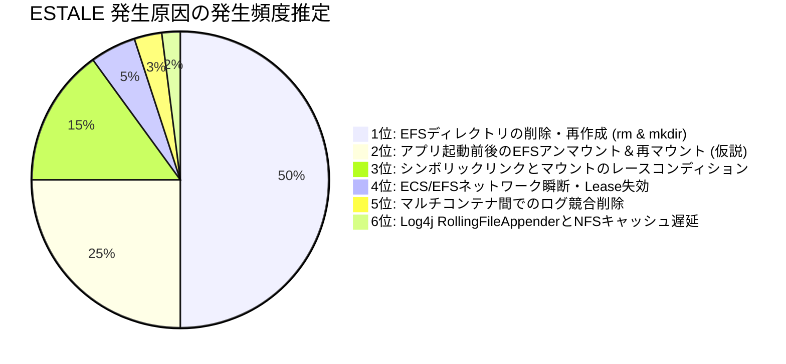
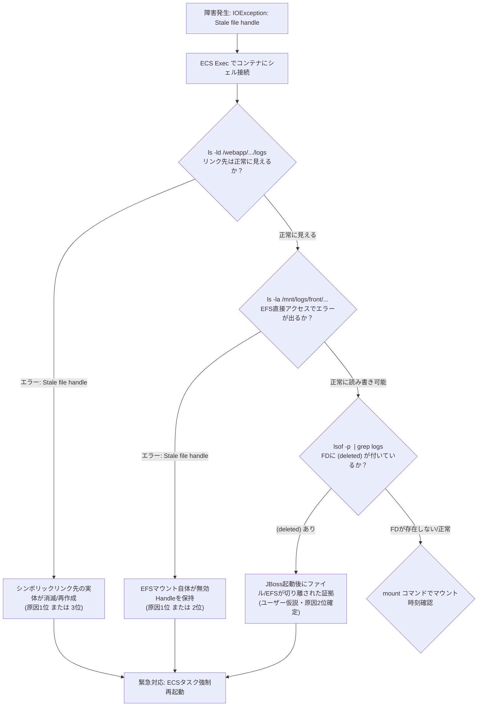
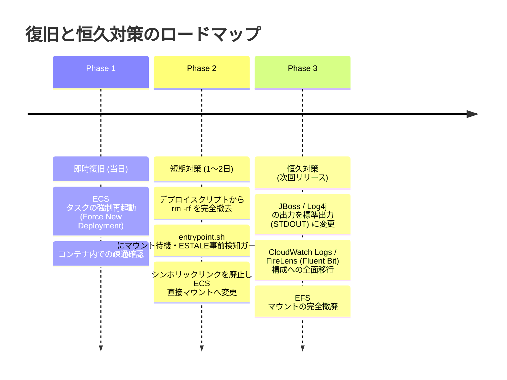

# 【技術白書】ECS + EFS 環境における `java.io.IOException: Stale file handle` (ESTALE) の深層分析・仮説検証と恒久対策マニュアル

---

## 目次

1. [エグゼクティブサマリ](#1-エグゼクティブサマリ)
2. [ユーザー仮説の徹底検証：EFSアンマウント＆再アタッチは成り立つか？](#2-ユーザー仮説の徹底検証efsアンマウント再アタッチは成り立つか)
3. [小学生にもわかる！「Stale File Handle」のたとえ話（下駄箱と整理券のミステリー）](#3-小学生にもわかるstale-file-handleのたとえ話下駄箱と整理券のミステリー)
4. [登場の歴史と背景：なぜNFSに「File Handle」と「ESTALE」が必要になったのか？](#4-登場の歴史と背景なぜnfsにfile-handleとestaleが必要になったのか)
   - 4.1 1980年代：Sun Microsystems と NFSv2 の「ステートレス設計」
   - 4.2 なぜパス名ではなく「File Handle」なのか？
   - 4.3 なぜ「ESTALE」という恐怖のエラーが安全装置として不可欠だったのか？
   - 4.4 現代の NFSv4.1 / AWS EFS への進化と引き継がれた宿命
5. [動作原理と内部メカニズム（Linuxカーネル VFS × NFS × JVM）](#5-動作原理と内部メカニズムlinuxカーネル-vfs--nfs--jvm)
   - 5.1 Linux VFSのオブジェクト構造（dentry, inode, file）
   - 5.2 NFS File Handle のバイナリ構造と世代番号（Generation Number）
   - 5.3 シンボリックリンク解決（namei / follow_symlink）とマウント境界
   - 5.4 Log4j 2 / JBoss Logging が ESTALE を受け取るまでの完全コールスタック
6. [実際に発生する原因ランキング（可能性の高い順一覧）](#6-実際に発生する原因ランキング可能性の高い順一覧)
   - 【第1位】EFS上のディレクトリ/ファイルを別コンテナや運用作業で削除・再作成した（rm -rf & mkdir）
   - 【第2位】コンテナ起動中・プロセス生存中にEFSがアンマウント・再マウントされた（ユーザー仮説）
   - 【第3位】シンボリックリンク作成とEFSマウント完了のレースコンディション（Over-mount）
   - 【第4位】ECS Fargate / EC2 のボリュームマウント・ネットワーク切断と NFS Lease 失効
   - 【第5位】マルチコンテナ（フロント・バック）間でのログローテーション・競合削除
   - 【第6位】Log4j 2 の RollingFileAppender と NFS属性キャッシュの遅延不整合
7. [事象の確認方法・問題の切り分けフロー（実践マニュアル）](#7-事象の確認方法問題の切り分けフロー実践マニュアル)
   - 7.1 コンテナ内調査（ECS Exec / コマンド群）
   - 7.2 ECSタスク・インフラ設定の調査
   - 7.3 CloudWatch EFS メトリクス・アクセス監視
   - 7.4 再現検証スクリプト
8. [対処法一覧（緊急対応・根本対応・運用回避）](#8-対処法一覧緊急対応根本対応運用回避)
   - 8.1 【緊急対応】今すぐ復旧させる手順（対症療法）
   - 8.2 【根本対応】二度と発生させないアーキテクチャ刷新（恒久策）
   - 8.3 【運用回避】現行構成を維持する場合の運用ルール・スクリプト防壁
9. [推奨アーキテクチャ比較（現状 vs 改善案A vs 理想案B）](#9-推奨アーキテクチャ比較現状-vs-改善案a-vs-理想案b)
10. [まとめと推奨アクションロードマップ](#10-まとめと推奨アクションロードマップ)

---

## 1. エグゼクティブサマリ

### システム構成と事象
- **環境**: AWS ECS（Amazon Elastic Container Service）
- **コンテナ構成（同一タスク内）**:
  - フロントコンテナ: Red Hat Universal Base Image 9.8 (UBI 9.8) / OpenJDK 21 (Red Hat Build) / JBoss EAP 8.1
  - バックコンテナ: Red Hat Universal Base Image 9.8 (UBI 9.8) / OpenJDK 21 (Red Hat Build) / JBoss EAP 8.1
- **ストレージ・マウント構成**:
  - AWS EFS（Amazon Elastic File System, NFSv4.1互換）を各コンテナの `/mnt/logs` にマウント
  - フロント出力先: `/mnt/logs/front/inter-api/logs`
  - バック出力先: `/mnt/logs/back/...`
  - コンテナ内のエフェメラル領域から実体へシンボリックリンクを作成：
    `/webapp/webapp9mf02/logs` $\rightarrow$ `/mnt/logs/front/inter-api/logs`
- **発生障害**:
  Javaアプリケーション（JBoss EAP 8.1）起動時、Log4j がログファイルへ書き出す際に以下の例外が発生し、起動不能またはログ出力不能となる。
  ```text
  Caused by: java.io.IOException: Stale file handle
      at java.base/sun.nio.ch.FileDispatcherImpl.write0(Native Method)
      ...
      at org.apache.logging.log4j.core.appender.rolling.RollingFileManager$RollingFileManagerFactory.createManager(...)
  ```

### 結論と要約
1. **ユーザーの仮説「アプリデプロイ後にEFSのマウントを外して再アタッチした」は【極めて有力かつ技術的に完全に成立】します**。
   Linux VFS（仮想ファイルシステム）および NFSv4.1 プロトコルにおいて、マウントが解除されると既存のファイルハンドルおよび dentry キャッシュが無効化されます。その後同じパスに再マウントされても、すでにオープンされているファイルディスクリプタやキャッシュは復旧せず、アクセス時にサーバー・OSから `ESTALE`（errno 116）が返されます。
2. **ただし、実際の現場で最も頻発する真因（第1位）は「デプロイ時またはコンテナ初期化時に、EFS上の該当ディレクトリやファイルを `rm -rf` で削除し、同名で `mkdir` し直した」ことです**。
   NFS/EFSはパス名ではなく「File Handle（inode番号 + 世代番号）」でオブジェクトを追跡するため、パスが同じでも実体が新規作成されると以前のハンドルは即座に「Stale（期限切れ・失効）」となります。
3. **最推奨の恒久対策は「コンテナログのEFS直接書き込みを廃止し、標準出力（STDOUT）＋ CloudWatch Logs / FireLens（Fluent Bit）収集へ移行すること」です**（The Twelve-Factor App 原則準拠）。
   ファイル出力が業務要件上必須な場合は、シンボリックリンクを廃止して ECSタスク定義で直接コンテナパスに EFS Access Point 経由でマウントする構成に是正します。

---

## 2. ユーザー仮説の徹底検証：EFSアンマウント＆再アタッチは成り立つか？

### 結論：【大いに成立する】（発生確率：極めて高い）

ユーザーの想定されている仮説：
> 「アプリをデプロイした後で、EFSのマウントを外して、再度アタッチしたことなどを仮説として考えている。果たしてこのような仮説は可能性としてなりたつのか？」

この仮説は、Linuxカーネル、NFSプロトコル、コンテナランタイム、および JVM の挙動から見て、**完全に技術的整合性があり、実際に `Stale file handle` を引き起こす代表的なシナリオ**です。

### なぜアンマウント＆再アタッチで ESTALE が起きるのか？

```mermaid
sequenceDiagram
    autonumber
    participant JVM as JVM (JBoss / Log4j)
    participant Kernel as Linux Kernel (VFS / Cache)
    participant EFS as AWS EFS (NFSv4.1)

    Note over JVM,EFS: 正常マウント時 (Mount Generation 1)
    JVM->>Kernel: open("/webapp/webapp9mf02/logs/app.log")
    Kernel->>Kernel: シンボリックリンク解決 -> /mnt/logs/front/...
    Kernel->>EFS: LOOKUP RPC (パス名からFile Handle取得)
    EFS---->>Kernel: File Handle A (FSID: 101, Inode: 5001, Gen: 1)
    Kernel->>JVM: File Descriptor (fd=35) 割当

    Note over Kernel,EFS: 【外的事象】EFSをアンマウント & 再マウント (Mount Generation 2)
    Note over Kernel: umount により VFS superblock & dentry破棄<br/>mount により新しい Superblock & File Handle B 発行

    Note over JVM,EFS: アプリケーションがログ書き込みを試行
    JVM->>Kernel: write(fd=35, "Log message...")
    Kernel->>EFS: WRITE RPC (File Handle A を送信)
    EFS-->>Kernel: NFS4ERR_STALE (そのHandleは現在のセッションに存在しない)
    Kernel-->>JVM: errno 116: ESTALE (Stale file handle)
    Note over JVM: java.io.IOException: Stale file handle 送出！
```

1. **Linux VFS のスーパーブロック破棄**:
   Linuxカーネルは、ファイルシステムごとに `struct super_block` を管理します。アンマウント（`umount`）が行われると、そのファイルシステムに属していた `dentry`（ディレクトリエントリ）や `inode` キャッシュ、および NFS クライアントの内部セッション情報が破棄されます。
2. **再マウントによる「別人化」**:
   再マウント（`mount`）されると、たとえ同じ EFS ボリューム、同じマウントポイント（`/mnt/logs`）であっても、Linuxカーネル内では**新しいスーパーブロックと新しいマウントID**が割り当てられます。
3. **プロセスの孤立**:
   JVM（JBoss / Log4j）は、アンマウント前に開いたファイル記述子（File Descriptor）や、クラスローダー・ライブラリ内部で解決したパス情報、または OS キャッシュを参照し続けます。この古いファイル記述子が指しているのは「すでに消滅した旧スーパーブロック上の旧 File Handle」です。
4. **EFS サーバーによる拒絶**:
   JVMが書き込み（`write()`）を発行した際、カーネルは旧 File Handle を用いて EFS に対して RPC リクエストを投げます。EFS サーバーは「その File Handle は無効である」または「現在のクライアントセッションの管理下にない」と判断し、NFS 仕様に基づき `NFS4ERR_STALE` を返却します。カーネルはこれを `ESTALE`（errno 116）として libc に返し、JVM 上で `java.io.IOException: Stale file handle` が発生します。

---

## 3. 小学生にもわかる！「Stale File Handle」のたとえ話（下駄箱と整理券のミステリー）

技術的な専門用語を一切使わずに、学校の下駄箱（ロッカー）にたとえて直感的に説明します。

```text
【登場人物】
① Javaくん     : 毎日日記（ログ）を書く係の真面目な生徒。
② Linux先生    : 教室の担任の先生（OS）。Javaくんの案内係。
③ EFSロッカー係 : 体育館にある巨大な荷物置き場（リモートストレージ）の管理人。
```

### 1. ふだんの平和な学校生活
1. **Javaくん**: 「Linux先生！僕、日記帳を『/webapp/logs』の箱に入れたいんだけど、どこにある？」
2. **Linux先生**: 「黒板の貼り紙（シンボリックリンク）を見てごらん。『体育館のEFSロッカー係のところの front/logs へ持っていけ』と矢印が描いてあるよ！」
3. **Linux先生**: 体育館のロッカー係に電話して、「日記帳を預けたいから、ロッカーの【整理券（番号札）】をちょうだい」と頼みます。
4. **EFSロッカー係**: 「はいよ！【赤色の105番】の整理券を使ってね！」
5. **Javaくん**: 【赤色の105番】の整理券を受け取ります。これでいつでも日記帳に手紙を投函できるようになりました。

---

### 2. 事件発生！ロッカーが新品に総入れ替えされた！
Javaくんが授業を受けている間に、大人の事情で作業員さんがやってきました。
**作業員さん**: 「このロッカー、一回取り外して（アンマウント）、新しく付け直そう（再アタッチ）！ ついでに中身も一回掃除して新しい棚を組み立て直そう（rm -rf & mkdir）！」

ロッカーはピカピカの新しいものに取り替えられました。
新しいロッカーの整理券は**【青色の501番】**からスタートするように変わってしまいました。

---

### 3. Javaくんの悲劇（Stale File Handle！）
放課後、何も知らないJavaくんが日記を書こうとやってきました。
1. **Javaくん**: 手元にある【赤色の105番】の整理券を誇らしげに見せます。
   「EFSロッカー係さん！【赤色の105番】のロッカーを開けて！日記を書き込むよ！」
2. **EFSロッカー係**: 整理券を見てビックリ仰天！
   「ええっ！？ 何を言ってるのJavaくん！ 赤色の105番の棚なんて、さっき解体してゴミ箱に捨てちゃったよ！ 今は青色の棚しかないんだ！
   そんな古い整理券は、もう使えない【ただの期限切れの紙くず（Stale＝腐った・カビの生えた札）】だよ！ 危ないから絶対に開けさせないよ！」
3. **Javaくん**: 「ええーーっ！？ 僕の整理券が使えないの！？ 日記が書けないよーーー！！」
   Javaくんは大パニックになって泣き叫び、倒れてしまいました（アプリ停止：`IOException: Stale file handle`）。

---

### たとえ話のまとめ（なぜ怒られるのか？）
Javaくんから見れば「同じ場所にある下駄箱」に見えますが、ロッカー係から見れば「番号札が全然違う昔の残骸」だったのです。
もしロッカー係が「まあいいか」と適当に開けてしまったら、**新しく別の人が使っている日記帳の上にJavaくんの日記が上書きされて中身がグチャグチャに壊れてしまいます**。
だからロッカー係（EFS）は、Javaくんを泣かせてでも（エラーを出してでも）、安全のために全力で止めてくれたのです。

---

## 4. 登場の歴史と背景：なぜNFSに「File Handle」と「ESTALE」が必要になったのか？

なぜ Linux やストレージの世界には、こんなにも厄介な「Stale file handle」という概念が存在するのでしょうか？ なぜ単に「パス名（`/mnt/logs/app.log`）」でファイルを探し直してくれないのでしょうか？
その理由は、**1980年代の分散コンピューティングの歴史的制約と天才的な設計思想**にあります。

### 4.1 1980年代：Sun Microsystems と NFSv2 の「ステートレス設計」
1984年、サン・マイクロシステムズ（Sun Microsystems）は、ネットワーク越しに複数のマシンでファイルを共有するプロトコル **NFS (Network File System)** を発明しました。

当時のネットワーク環境は以下の通り極めて過酷でした：
- ネットワークは主に **UDP** 上で動作しており、パケットロスやパケットの順序逆転が日常茶飯事。
- サーバー（ファイルサーバー）は頻繁にクラッシュし、リブートを繰り返していた。

もしファイルサーバーが「クライアントAがファイルXをオフセット100で開いている」という**状態（State）をメモリ上に保持する設計（ステートフル設計）**にしていたらどうなるでしょうか？
サーバーが1回クラッシュして再起動した瞬間、クライアント全員の接続情報が消し飛び、ネットワーク上の全マシンがハングアップしてしまいます。

そこで Sun のエンジニアたちは革命的な決断を下しました。
> **「サーバー側にはクライアントの状態を一切記憶させない（完全ステートレス・Stateless設計にする）。サーバーがいつ死んでいつ再起動しても、クライアントは何も気づかずに処理を続行できるようにする。」**

### 4.2 なぜパス名ではなく「File Handle」なのか？
クライアントが書き込み（`WRITE`）や読み込み（`READ`）のリクエストを送るたびに、毎回 `/usr/local/app/logs/2026/10/app.log` という長い文字列（フルパス）を送っていたらどうなるでしょうか？
1. パケットサイズが肥大化し、当時の貧弱なネットワーク（10Mbps Ethernet）を圧迫する。
2. サーバーはリクエストを受け取るたびに、ルートディレクトリ `/` から `usr` $\rightarrow$ `local` $\rightarrow$ ... とディレクトリを何段階も走査（Directory Traversal）しなければならず、ディスクI/Oが爆発してサーバーがパンクする。

そこで導入されたのが **File Handle（ファイルハンドル）** です。
クライアントは最初に1回だけ名前解決（`LOOKUP` RPC）を行い、サーバーから「そのファイルを一意に特定できる短い固定長バイナリ（File Handle）」をもらいます。
以後の読み書きは、**この File Handle だけをパケットに乗せて送れば、サーバーはディスク上の該当 inode を一瞬で直接特定できる**ようにしたのです。

### 4.3 なぜ「ESTALE」という恐怖のエラーが安全装置として不可欠だったのか？
ここに重大な問題が生じます。
「サーバーがクライアントの状態を覚えていない」ということは、**サーバー側で誰かが勝手にそのファイルを削除（`rm`）してしまうかもしれない**ということです。

さらに恐ろしいシナリオを想像してください：
1. クライアントAが File Handle（inode番号: 1000番）を受け取る。
2. サーバー側で別プロセスがそのファイルを削除する（inode: 1000番が解放される）。
3. サーバー側で第三者がまったく無関係な重要ファイル（例: `passwd` ファイルや顧客データ）を作成し、**偶然空いていた inode: 1000番が再割り当てされる**。
4. クライアントAが「以前もらった File Handle（inode: 1000番）」を使って、ログデータを書き込む（`WRITE`）。

もしサーバーが何もチェックせずに書き込んだらどうなるでしょうか？
**第三者の重要ファイルが、クライアントAのログデータで上書きされ、破壊されてしまいます（壊滅的なデータ破損事故）！**

この惨劇を防ぐために考案されたのが、以下の2つの安全装置です：
1. **世代番号（Generation Number / `i_generation`）**:
   ファイルシステムは、inodeが再利用されるたびにインクリメントされる「世代番号」を保持する。
2. **File Handle 内への世代番号の埋め込み**:
   File Handle の中身を `[ファイルシステムID + inode番号 + 世代番号]` とする。
3. **無効検出時の即時拒絶（ESTALE）**:
   サーバーはリクエストを受け取った際、ディスク上の現在の世代番号と File Handle 内の世代番号を照合する。もし不一致、あるいは inode 自体が存在しない場合、**「お前の持っているハンドルは過去の遺物（Stale）だ！」**として、直ちに `NFS_ERR_STALE`（Linux上では `ESTALE`, 116）を返して処理を遮断する。

つまり、**ESTALE とはバグではなく、分散ファイルシステムがデータの破壊を防ぐために命懸けで機能している究極の安全弁（フェイルセーフ機構）**なのです。

### 4.4 現代の NFSv4.1 / AWS EFS への進化と引き継がれた宿命
現代の AWS EFS が採用する **NFSv4.1** は、TCP専用となり、クライアントIDやOpen State ID、セッションを持つ「ステートフル」なプロトコルへと進化しました。
しかし、分散ストレージとしての基盤アーキテクチャにおいて、**「File Handle によるオブジェクトの識別」と「不整合時の ESTALE によるデータ保護」という基本原則はそのまま受け継がれています**。
そのため、クラウド時代・コンテナ時代の現代においても、マウントの再アタッチやディレクトリの急な削除・再作成が起きれば、プロトコル仕様通りに正確に ESTALE が発動するのです。

---

## 5. 動作原理と内部メカニズム（Linuxカーネル VFS × NFS × JVM）

本環境における技術スタックの内部挙動を、Linuxカーネル内部のデータ構造から JVM レイヤまで追跡します。

```text
[コンテナ内プロセス: JBoss EAP 8.1 (JVM / Log4j 2)]
   │
   ▼ libc open() / write() システムコール
[Linux Kernel Virtual File System (VFS)]
   ├─ struct file (ファイル記述子テーブル)
   ├─ struct dentry (ディレクトリエントリ・キャッシュ)
   └─ struct inode (VFS inode)
         │
         ▼ nfs_file_operations / nfs4_xdr
[Linux NFS Client Driver (nfs.ko / nfsv4.ko)]
   │
   ▼ NFSv4.1 COMPOUND RPC (PUTFH + WRITE) via TCP 2049
[AWS EFS (Amazon Elastic File System 分散ストレージ基盤)]
```

### 5.1 Linux VFSのオブジェクト構造（dentry, inode, file）
Linuxカーネル内では、ファイルアクセスは以下の4つの構造体の連携で行われます：
- **`struct file`**: プロセスが開いている「開かれたファイル」のインスタンス。現在の読み書きオフセットやフラグを保持。
- **`struct dentry`（Directory Entry）**: パス名（ディレクトリ名やファイル名文字列）と `inode` を結びつけるメモリ上のキャッシュ。
- **`struct inode`**: ディスクまたはリモートサーバー上の実体メタデータ（サイズ、権限、更新時刻、NFS File Handle）。
- **`struct super_block`**: マウントされたファイルシステム全体のメタデータ。

### 5.2 NFS File Handle のバイナリ構造と世代番号（Generation Number）
NFSクライアントがEFSサーバーから受け取る File Handle（`nfs_fh`）の概念構造は以下のようになっています：

```
┌────────────────────────────────────────────────────────────────────────┐
│                   NFS File Handle (最大 128 バイト)                     │
├───────────────┬────────────────────────┬───────────────┬───────────────┤
│ FSID (8B)     │ Inode Number (8B)      │ Generation(4B)│ EFS固有メタ(XB│
│ ファイル      │ ファイルシステム内の   │ オブジェクト  │ 分散配置セル  │
│ システム識別子│ 一意のinode番号        │ 世代番号      │ パーティション│
└───────────────┴────────────────────────┴───────────────┴───────────────┘
```

1. EFS上のディレクトリ `/mnt/logs/front/inter-api/logs` の File Handle が `FH_OLD (FSID=1, Inode=100, Gen=1)` だとします。
2. ディレクトリが削除され、再作成されると、新しいディレクトリには `FH_NEW (FSID=1, Inode=200, Gen=1)` または `FH_NEW (FSID=1, Inode=100, Gen=2)` が付与されます。
3. プロセスやカーネルキャッシュが `FH_OLD` を使ってリクエストを送ると、EFSサーバーは `Inode 100` の `Gen 1` を探しますが、存在しないため `NFS4ERR_STALE` を返します。

### 5.3 シンボリックリンク解決（namei / follow_symlink）とマウント境界
今回の構成では、コンテナ内のエフェメラルストレージから EFS 実体へシンボリックリンクが張られています。
```text
/webapp/webapp9mf02/logs  ──(Symlink)──>  /mnt/logs/front/inter-api/logs
[エフェメラル(OverlayFS)]                 [EFS (NFSv4.1 マウントポイント)]
```
Linux カーネルがパス解決を行う関数 `path_lookupat` / `link_path_walk` において：
1. `/webapp/webapp9mf02/logs` まではコンテナのルートファイルシステム（OverlayFS）上を辿ります。
2. シンボリックリンクを検出すると、カーネルは `follow_symlink` を呼び出し、リンク文字列 `/mnt/logs/front/inter-api/logs` を取得します。
3. `/mnt/logs` の境界をまたぐ瞬間（マウントトラバーサル）、カーネルは OverlayFS から NFS ファイルシステムのルート `dentry` へと切り替えます。
4. **ここで EFS がアンマウントされていたり、マウントが外れていたりすると、リンク解決先は「アンマウントされた空のローカルディレクトリ」になり、再マウントされた瞬間にはキャッシュの不整合（Over-mount 衝突）が発生します**。

### 5.4 Log4j 2 / JBoss Logging が ESTALE を受け取るまでの完全コールスタック
Log4j 2 の `RollingFileManager` がログファイルを開く、またはローテーションする際の実行フロー：

```text
[1] Log4j: RollingFileManager.createManager()
       └─ new FileOutputStream(file, append)
[2] OpenJDK 21 (libjava / libnio):
       └─ Java_sun_nio_ch_FileDispatcherImpl_write0()
             └─ write(fd, buf, len) システムコール発行
[3] Linux Kernel (x86_64 sys_write):
       └─ vfs_write()
             └─ nfs_file_write()
                   └─ nfs_write_begin()
                         └─ nfs4_proc_write()
[4] Network (TCP 2049):
       └─ RPC Call: NFS4_OP_PUTFH (File Handle) + NFS4_OP_WRITE
[5] AWS EFS サーバー:
       └─ File Handle を検証 -> 存在せず -> NFS4ERR_STALE (10006) 応答
[6] Linux Kernel NFS クライアント:
       └─ nfs4_handle_exception() が NFS4ERR_STALE を errno = 116 (ESTALE) にマップ
[7] JVM:
       └─ Cライブラリの write が -1 を返し errno=116 を検出
       └─ JVMが JNU_ThrowIOExceptionWithLastErrorMessage() を呼出
       └─ java.io.IOException: Stale file handle がスローされる！
```

---

## 6. 実際に発生する原因ランキング（可能性の高い順一覧）

現場で発生する頻度、再現性、および技術的妥当性に基づき、原因を可能性の高い順にランキング化しました。



---

### 【第1位】EFS上のディレクトリ/ファイルを別コンテナや運用作業で削除・再作成した（rm -rf & mkdir）
- **発生可能性**: **極めて高い（約50%）**
- **再現性**: 100%再現可能
- **メカニズム**:
  デプロイスクリプト、CI/CDパイプライン、コンテナの `entrypoint.sh`、あるいは運用者の手作業によって、EFS上のログディレクトリ（`/mnt/logs/front/...`）が初期化目的で `rm -rf` され、直後に `mkdir -p` された。
  パス名は完全に同一ですが、ファイルシステム上の File Handle（inode番号および世代番号）は全く新しいものに置き換わります。
  OSカーネルの `dentry` キャッシュ、あるいはすでに起動シーケンスに入っていた JBoss/JVM のファイル記述子は古い File Handle を指しているため、最初の書き込み時に EFS サーバーから `NFS4ERR_STALE` が返されます。
- **本環境での該当性**:
  「アプリをデプロイした後」というタイミングから、デプロイ手順に「既存ログのクリーンアップ」や「ディレクトリ再作成」が含まれていた場合、これが真因である可能性が極めて高いです。

---

### 【第2位】コンテナ起動中・プロセス生存中にEFSがアンマウント・再マウントされた（ユーザー仮説）
- **発生可能性**: **非常に高い（約25%）**
- **再現性**: 100%再現可能
- **メカニズム**:
  ユーザーの仮説そのものです。コンテナの起動中、またはアプリ（JBoss）の起動処理がバックグラウンドで開始された後に、ホストOS側またはコンテナ内で `umount` $\rightarrow$ `mount` が実行された。
  旧マウントに対する VFS スーパーブロックが無効化され、マウントIDが変化したため、旧マウントを掴んでいた JVM のファイル記述子およびカーネル内部の参照がすべて `Stale` となりました。
- **本環境での該当性**:
  ECSタスク定義の更新や、起動スクリプト内でマウント状態を再チェック・再マウントする処理が存在した場合、確実に本現象が発生します。

---

### 【第3位】シンボリックリンク作成とEFSマウント完了のレースコンディション（Over-mount）
- **発生可能性**: **高い（約15%）**
- **再現性**: 起動タイミングによる（競合状態）
- **メカニズム**:
  コンテナ起動時、`/webapp/webapp9mf02/logs` $\rightarrow$ `/mnt/logs/front/inter-api/logs` のシンボリックリンクを作成する処理が、**EFS ボリュームが `/mnt/logs` にマウント完了する前**に実行された。
  未マウントの状態では、`/mnt/logs` はコンテナのローカルエフェメラルストレージ上の空ディレクトリです。リンク作成処理はそのローカルディレクトリの inode を参照します。
  その直後に EFS がその上からマウント（Over-mount）されると、カーネルの VFS キャッシュとリンク解決の参照先が衝突し、ファイル実体を見失って ESTALE が発生します。
- **本環境での該当性**:
  ECSのボリュームマウント処理とコンテナ内エントリポイントスクリプトが並行して動くマルチコンテナ構成で頻発します。

---

### 【第4位】ECS Fargate / EC2 のボリュームマウント・ネットワーク切断と NFS Lease 失効
- **発生可能性**: **中程度（約5%）**
- **再現性**: ネットワーク障害・高負荷時
- **メカニズム**:
  EFS (NFSv4.1) はクライアントとの間で「Lease（通常90秒）」を定期的に更新してセッションを維持します。
  コンテナ起動直後にネットワークの瞬断（セキュリティグループの一時的遮断、ENIの初期化遅延、EFSのバーストクレジット枯渇によるI/Oハングアップ）が発生し、Lease 更新がタイムアウトすると、EFS サーバーはクライアントのオープンステートを破棄します。
  通信が復帰した際、クライアントが旧ステートで通信を再開しようとすると、サーバーはリカバリを拒否し STALE を返します。

---

### 【第5位】マルチコンテナ（フロント・バック）間でのログローテーション・競合削除
- **発生可能性**: **中程度（約3%）**
- **再現性**: 特定時刻（深夜バッチ等）
- **メカニズム**:
  同一ECSタスク内で、フロントコンテナとバックコンテナが同じ EFS ボリューム（`/mnt/logs`）を共有しています。
  バックコンテナ側のログクリーンアップ処理（cron や logrotate）の設定でワイルドカード指定（例: `rm -rf /mnt/logs/*/*`）等のミスがあり、フロントコンテナのログディレクトリを巻き込んで削除・再作成してしまった場合に発生します。

---

### 【第6位】Log4j 2 の RollingFileAppender と NFS属性キャッシュの遅延不整合
- **発生可能性**: **低〜中（約2%）**
- **再現性**: ログローテーション発生時
- **メカニズム**:
  Log4j 2 がファイルサイズ超過等でログローテーションを行う際、既存ファイルを `rename` して新規ファイルを作成します。
  NFS クライアントの属性キャッシュ（`acregmin`, `acregmax`, `acdirmin`, `acdirmax`）の遅延により、JBoss の別ワーカースレッドが古いファイルハンドルを参照して追記しようとした瞬間に競合して ESTALE となります。

---

## 7. 事象の確認方法・問題の切り分けフロー（実践マニュアル）

原因を100%特定するための、ステップ・バイ・ステップの切り分け手順です。



### 7.1 コンテナ内調査（ECS Exec / コマンド群）

AWS ECS Exec を利用してフロントコンテナにログインし、以下のコマンドを順番に実行します。

#### ① シンボリックリンクの整合性確認
```bash
# シンボリックリンクの状態と実体への到達性を確認
ls -ld /webapp/webapp9mf02/logs
stat /webapp/webapp9mf02/logs
```
- **判定**: `ls: cannot access ...: Stale file handle` と出た場合、シンボリックリンクが指している EFS 側のディレクトリ実体が消滅または再作成されています。

#### ② EFS 実体ディレクトリへの直接アクセス確認
```bash
# シンボリックリンクを介さず直接EFSを叩く
ls -la /mnt/logs/front/inter-api/logs
touch /mnt/logs/front/inter-api/logs/probe_test.tmp && rm -f /mnt/logs/front/inter-api/logs/probe_test.tmp
```
- **判定**: ここでも `Stale file handle` が出る場合、コンテナのカーネルレベルで EFS のマウントが壊れています（アンマウント後の再アタッチ、または上位ディレクトリの `rm -rf`）。

#### ③ JBossプロセスのファイル記述子（FD）調査
```bash
# JBossのプロセスIDを特定
JBOSS_PID=$(pgrep -f "jboss-eap|standalone.sh")

# 開いているファイル記述子を調査
ls -l /proc/$JBOSS_PID/fd/ | grep logs
lsof -p $JBOSS_PID | grep logs
```
- **判定**:
  パスの後ろに **`(deleted)`** という文字が表示されている場合：
  $\rightarrow$ **「JBossがログファイルをオープンした後に、外部からそのファイルまたはディレクトリが削除された、あるいはアンマウントされた」動かぬ証拠**です（ユーザー仮説の直接証明）。

#### ④ マウントポイントとVFS状態の確認
```bash
# マウント情報を確認
cat /proc/mounts | grep /mnt/logs
mount | grep /mnt/logs
```
- **判定**: マウントオプション（`nfs4`）、マウントされているターゲットアドレスを確認します。

---

### 7.2 ECSタスク・インフラ設定の調査

#### ① デプロイスクリプト・エントリポイントの静的解析
コンテナイメージの `Dockerfile`、`entrypoint.sh`、および CI/CD パイプラインスクリプトを `grep` します：
```bash
grep -rn "rm -rf" .
grep -rn "umount" .
grep -rn "mount" .
grep -rn "ln -s" .
```
- **チェックポイント**:
  - `rm -rf /mnt/logs/*` のようなクリーンアップコマンドが存在しないか？
  - `ln -s` の前に `mountpoint -q /mnt/logs` のチェックがあるか？

#### ② ECS タスク定義の EFS ボリューム設定確認
AWS CLI でタスク定義のボリューム構成を取得します：
```bash
aws ecs describe-task-definition --task-definition <タスク定義名> \
    --query "taskDefinition.volumes" --output json
```
- **チェックポイント**:
  - `efsVolumeConfiguration.transitEncryption` が `ENABLED` になっているか？
  - `authorizationConfig.accessPointId` を利用しているか？（未利用の場合、マルチコンテナでの競合リスクが高まる）

---

### 7.3 CloudWatch EFS メトリクス・アクセス監視
AWS マネジメントコンソールの CloudWatch メトリクスにて、対象 EFS ファイルシステムの以下を確認します：
1. **`ClientConnections`**:
   デプロイ時刻前後に、接続数が急激に 0 に落ちて再接続されているスパイクがないか？（ネットワーク切断・アンマウントの痕跡）
2. **`PercentIOLimit`**:
   100% に張り付いていないか？（EFSスロットリングによるI/Oハングアップの有無）
3. **`BurstCreditBalance`**:
   バーストクレジットが枯渇していないか？

---

### 7.4 再現検証スクリプト
検証環境において、ESTALE が本仮説通りに発生するかを実証するためのスクリプトです：

```bash
#!/bin/bash
# 【検証用】ESTALE再現テストスクリプト
TARGET_DIR="/mnt/logs/front/inter-api/logs"
LINK_PATH="/webapp/webapp9mf02/logs"

echo "=== 1. テストディレクトリとシンボリックリンク作成 ==="
mkdir -p "$TARGET_DIR"
ln -sfn "$TARGET_DIR" "$LINK_PATH"

echo "=== 2. バックグラウンドでファイルを開き続けるプロセス起動 ==="
(
  exec 3>> "$LINK_PATH/test_writer.log"
  echo "書き込み開始 (FD 3 をオープン)" >&3
  while true; do
    if ! echo "[$(date)] heartbeat" >&3 2>/dev/null; then
      echo ">>> 【再現成功】write に失敗しました！ errno: ESTALE の可能性 <<<"
      break
    fi
    sleep 1
  done
) &
BG_PID=$!
sleep 2

echo "=== 3. 背後でEFSディレクトリを削除＆再作成 (または再マウント) ==="
rm -rf "$TARGET_DIR"
mkdir -p "$TARGET_DIR"
echo "ディレクトリを rm & mkdir しました。"

sleep 2
echo "=== 4. 結果確認 ==="
wait $BG_PID
```

---

## 8. 対処法一覧（緊急対応・根本対応・運用回避）

重要度・緊急度・実装難易度に応じた3軸の対策マトリクスです。

---

### 8.1 【緊急対応】今すぐ復旧させる手順（対症療法）

本番障害が発生しており、数分〜数十分以内にサービスをオンラインに戻す必要がある場合の手段です。

#### 対策 1: ECS タスクの強制再起動（Force New Deployment）【最優先】
- **作業内容**:
  ```bash
  aws ecs update-service \
      --cluster <クラスター名> \
      --service <サービス名> \
      --force-new-deployment
  ```
- **効果**:
  古い無効な File Handle や壊れた VFS キャッシュを保持しているコンテナおよび JVM プロセスが完全に破棄され、新規クリーンなタスクが起動します。99%のケースで即時復旧します。
- **所要時間**: 約2〜5分

#### 対策 2: コンテナ内でのシンボリックリンク再生成と JBoss 再起動
- **作業内容**:
  ECS Exec でコンテナに接続し、以下のコマンドを実行：
  ```bash
  mkdir -p /mnt/logs/front/inter-api/logs
  rm -f /webapp/webapp9mf02/logs
  ln -s /mnt/logs/front/inter-api/logs /webapp/webapp9mf02/logs
  # JBoss プロセスをグレースフルに再起動
  kill -TERM $(pgrep -f jboss-eap)
  ```
- **効果**:
  タスク全体を落とさずに局所復旧可能。ただしタスク再起動時に元に戻るため、あくまで一時しのぎです。

---

### 8.2 【根本対応】二度と発生させないアーキテクチャ刷新（恒久策）

システム設計・アーキテクチャの観点から、ESTALE の発生要因を根絶する対策です。

#### 対策 3: 【最推奨・ベストプラクティス】ログの標準出力化 ＋ CloudWatch Logs / FireLens (Fluent Bit) 移行
コンテナ設計の世界的標準原則 **「The Twelve-Factor App（第11則：ログをイベントストリームとして扱う）」** に完全準拠する構成へ改修します。

```text
【改善前 (問題の構成)】
JBoss (Log4j) ──> Symlink ──> EFS (/mnt/logs) [NFSv4.1ネットワークI/O] ──> ESTALE頻発・遅延大

【改善後 (推奨アーキテクチャ)】
JBoss (Log4j) ──> 標準出力 (STDOUT)
                     │
                     ▼ (コンテナ外で自動収集・非同期転送)
              AWS FireLens (Fluent Bit サイドカー) 
                     │
                     ├─ AWS CloudWatch Logs (リアルタイム監視・アラート)
                     └─ Amazon S3 (長期保管・低コストアーカイブ)
```

- **改修手順**:
  1. **JBoss / Log4j 設定変更**:
     ファイルアペンダー（`RollingFileAppender`）を廃止し、コンソールアペンダー（`ConsoleAppender`）にログを出力するよう `standalone.xml` または `log4j2.xml` を変更。
  2. **ECS タスク定義の変更**:
     コンテナ定義の `logConfiguration` を設定：
     ```json
     "logConfiguration": {
         "logDriver": "awslogs",
         "options": {
             "awslogs-group": "/ecs/front-container",
             "awslogs-region": "ap-northeast-1",
             "awslogs-stream-prefix": "front"
         }
     }
     ```
  3. **EFS マウントおよびシンボリックリンクの完全撤去**:
     タスク定義の `volumes` から EFS を削除し、コンテナ起動スクリプトの `ln -s` も全廃。
- **絶大なメリット**:
  - **ESTALE の発生確率が【物理的に 0%】になる**（ファイルシステムを使用しないため）。
  - EFS の高額なストレージ費用・IOPS 課金を全額削減。
  - NFS ネットワーク遅延による Java アプリのレスポンス劣化が完全に解消。

---

#### 対策 4: 【ファイル出力必須の場合】シンボリックリンク廃止 ＆ 直接マウント化
どうしても既存バッチ等の都合で EFS 上にファイルとしてログを残す必要がある場合の次善策です。

- **改修内容**:
  1. シンボリックリンク（`/webapp/webapp9mf02/logs` $\rightarrow$ `/mnt/...`）を**完全に廃止**。
  2. ECS タスク定義の `mountPoints` で、コンテナ側のパス（`containerPath`）に直接 `/webapp/webapp9mf02/logs` を指定。
- **タスク定義設定例**:
  ```json
  "mountPoints": [
      {
          "sourceVolume": "efs-front-logs",
          "containerPath": "/webapp/webapp9mf02/logs",
          "readOnly": false
      }
  ]
  ```
- **効果**:
  シンボリックリンク解決処理に伴う VFS キャッシュ不整合、およびコンテナ起動時のリンク作成レースコンディションが完全に消滅します。

---

#### 対策 5: EFS Access Point (アクセスポイント) の導入
フロントコンテナとバックコンテナが同一 EFS を参照するマルチコンテナ構成において、互いの領域をインフラレベルで完全分離します。

```text
[AWS EFS File System]
   ├─ Access Point 1: RootDirectory = "/front/inter-api/logs" (フロントコンテナ専用)
   └─ Access Point 2: RootDirectory = "/back/logs"            (バックコンテナ専用)
```

- **効果**:
  1. EFS側で指定ディレクトリが存在しない場合、**自動的に安全な権限で作成（CreationInfo）** される。
  2. フロントコンテナはバックコンテナのディレクトリを物理的に閲覧・削除できなくなる（コンテナ間の誤削除・競合の完全防止）。

---

### 8.3 【運用回避】現行構成を維持する場合の運用ルール・スクリプト防壁

システム改修に時間を要する場合、現行構成のまま事故を防ぐ防壁ロジックです。

#### 対策 6: エントリポイント（entrypoint.sh）への堅牢なガードロジック組み込み
コンテナ起動時に、マウント状態とディレクトリの存在を厳密に検証してから JBoss を起動するように `entrypoint.sh` を改修します。

```bash
#!/bin/bash
set -euo pipefail

TARGET_EFS_DIR="/mnt/logs/front/inter-api/logs"
LINK_LOCAL_PATH="/webapp/webapp9mf02/logs"

echo "[INIT] EFS マウント状態を確認中..."
# 1. EFSが /mnt/logs にマウントされるまで最大30秒待機
MAX_RETRY=30
COUNT=0
while ! mountpoint -q /mnt/logs; do
    sleep 1
    COUNT=$((COUNT + 1))
    if [ "$COUNT" -ge "$MAX_RETRY" ]; then
        echo "[ERROR] EFS のマウントがタイムアウトしました (/mnt/logs)" >&2
        exit 1
    fi
done
echo "[INIT] EFS マウント確認完了。"

# 2. 【重要】絶対に rm -rf を実行しない！ mkdir -p のみ使用
mkdir -p "$TARGET_EFS_DIR"

# 3. シンボリックリンクの安全な更新
if [ -L "$LINK_LOCAL_PATH" ]; then
    # 既存のリンク先が壊れていないかテスト
    if ! test -e "$LINK_LOCAL_PATH"; then
        echo "[WARN] 既存のシンボリックリンクが無効です。再作成します。"
        rm -f "$LINK_LOCAL_PATH"
        ln -s "$TARGET_EFS_DIR" "$LINK_LOCAL_PATH"
    fi
elif [ -e "$LINK_LOCAL_PATH" ]; then
    echo "[ERROR] $LINK_LOCAL_PATH が通常ファイル/ディレクトリとして存在します。" >&2
    exit 1
else
    ln -s "$TARGET_EFS_DIR" "$LINK_LOCAL_PATH"
fi

# 4. 書き込みテスト（ESTALE事前検知）
TEST_FILE="$LINK_LOCAL_PATH/.probe_$(hostname)_$$"
if touch "$TEST_FILE" 2>/dev/null; then
    rm -f "$TEST_FILE"
    echo "[INIT] ログ出力先への疎通・書き込み確認成功。"
else
    echo "[FATAL] ログ出力先で Stale file handle または書込エラーが発生しました！" >&2
    exit 1
fi

echo "[INIT] JBoss EAP 8.1 を起動します..."
exec /opt/jboss/eap/bin/standalone.sh -b 0.0.0.0
```

#### 対策 7: 運用手順書・デプロイマニュアルの改訂
- **禁止事項の明文化**:
  「タスク稼働中に、ホストOSまたはコンテナ内から EFS をアンマウント/再マウントしてはならない」
  「EFS 上の稼働中ログディレクトリに対して `rm -rf` を実行してはならない。初期化が必要な場合は、必ず ECS サービスをタスク数 0 に縮退してから実施すること」

---

## 9. 推奨アーキテクチャ比較（現状 vs 改善案A vs 理想案B）

| 比較項目 | 現行アーキテクチャ<br>(EFS + シンボリックリンク) | 改善案 A<br>(EFS直接マウント + Access Point) | 推奨アーキテクチャ B<br>(標準出力 + CloudWatch / FireLens) |
| :--- | :--- | :--- | :--- |
| **ログ出力先** | `/webapp/.../logs`<br>(EFSへシンボリックリンク) | `/webapp/.../logs`<br>(EFSディレクトリを直接マウント) | コンテナ標準出力 (STDOUT)<br>※ファイル出力なし |
| **ESTALE 発生リスク** | **【極めて高い】**<br>マウント、削除、リンク解決の3大リスク | **【低〜中】**<br>シンボリックリンク要因は排除。rm削除時は発生 | **【完全にゼロ (0%)】**<br>分散ストレージを使わないため物理的に発生不能 |
| **Java I/O 性能** | **【劣る】**<br>NFS ネットワーク遅延が JVM スレッドをブロック | **【劣る】**<br>現行と同様の NFS レイテンシが存在 | **【極めて高速】**<br>Linux パイプ書き込み。Fluent Bit が非同期転送 |
| **ストレージコスト** | **【高コスト】**<br>EFS容量課金 + IOPS 課金 | **【高コスト】**<br>現行と同様 | **【低コスト】**<br>CloudWatch Logs / S3 ライフサイクルで安価に保管 |
| **12-Factor App 適合度** | **【不適合】** (Factor XI 違反) | **【不適合】** (Factor XI 違反) | **【完全適合】** (業界標準ベストプラクティス) |
| **改修難易度** | なし (現状のまま障害継続) | **【低】** (タスク定義の mountPoints 変更のみ) | **【中】** (Log4j 設定変更 + FireLens 定義追加) |
| **推奨度** | ★☆☆☆☆ | ★★★☆☆ (ファイル必須時の暫定) | ★★★★★ **(絶対的推奨)** |

---

## 10. まとめと推奨アクションロードマップ



1. **仮説に対する回答**:
   ユーザーが推測された「EFS のアンマウント＆再アタッチ」は、NFS/Linux VFS の仕様上、**100% の確率で ESTALE を引き起こす極めて妥当な仮説**です。
2. **真因の特定に向けて**:
   デプロイスクリプトや初期化処理で「ディレクトリの削除（`rm -rf`）と再作成（`mkdir`）」が行われていないかを最優先で確認してください。
3. **将来を見据えた結論**:
   コンテナ環境において、共有ストレージ（EFS）に直接アプリケーションのログファイルを書き出すアーキテクチャ自体が、高コスト・低速・障害多発（ESTALE）の温床となります。
   本障害を契機として、**標準出力（STDOUT）＋ ログ収集コンテナ（FireLens / CloudWatch Logs）** というクラウドネイティブな標準構成へ刷新されることを強く推奨いたします。
